  

  

  

  

**Software Platform Systems Engineer** based in Barcelona. I mostly write **Go**, and I spend my time on
platforms that have to stay up: high availability, resiliency, scalability and security for production systems.

Outside of work I like to rebuild things from scratch to see how they actually work: storage engines, inference
runtimes, GPU monitors.

  

<!-- JOKE-START -->
Java and C were telling jokes. It was C's turn, so he writes something on the wall, points to it and says "Do you get the reference?" But Java didn't.
<!-- JOKE-END -->
